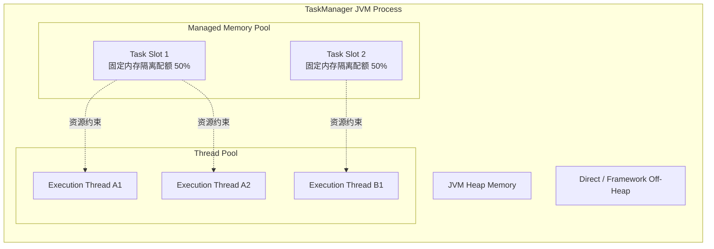
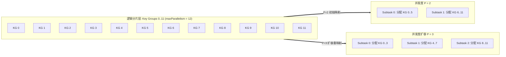
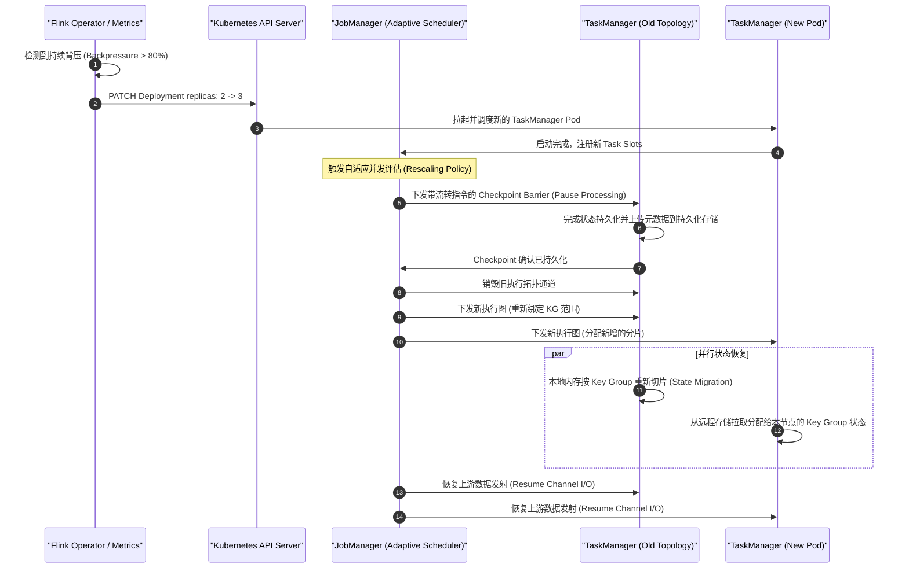
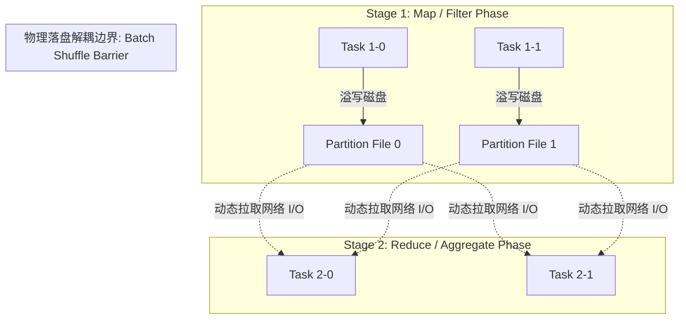
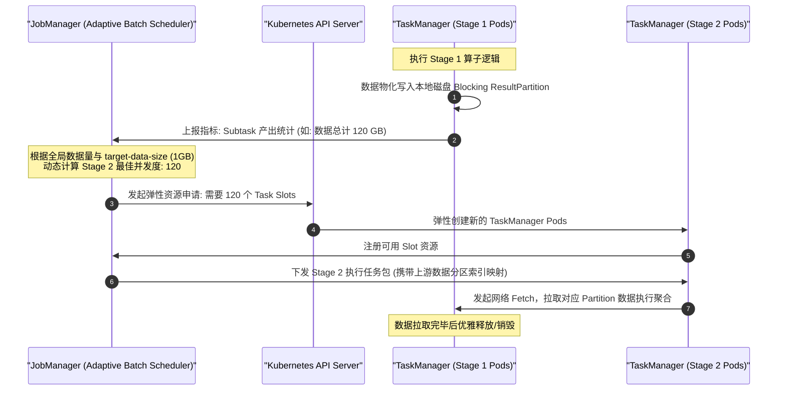
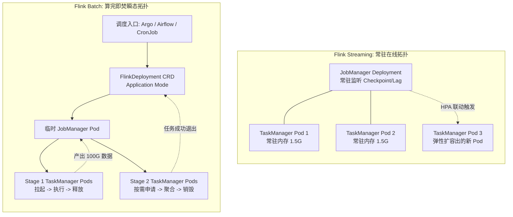

# 深入剖析 Apache Flink 流批双引擎的动态扩缩容架构：机制演进、状态重对齐与生产落地推导

> 日期：2026年10月  
> 标签：`Apache Flink` `Kubernetes` `Distributed Systems` `Stream Processing` `Batch Computing` `Architecture Deep-Dive`

---

## 导言：为什么需要统一审视流与批的弹性机制？

在分布式大数据计算架构演进中，资源的弹性伸缩（Elastic Scaling）始终是基础设施与计算框架之间博弈的核心地带。

批计算（Batch）与流计算（Streaming）天然具有截然相反的执行哲学：
* **批计算（有界数据集）**：追求吞吐量（Throughput）与完工时间（Make-span）。计算是阶段性的，任务具有生命周期起点与终点，故障容忍倾向于重试未完成的局部 Stage。
* **流计算（无界数据流）**：追求端到端低延迟（Low Latency）与状态连续性（State Continuity）。任务理论上永不停机，拓扑常驻，状态（State）与事件时间（Event Time）必须毫秒级精准自洽。

当这两种模式统一在 Apache Flink 计算引擎内部时，分布式运行时的弹性伸缩机制产生了本质维度的分水岭：**流计算扩缩容的本质是“有状态拓扑在分布式通道间的切分、持久化与重对齐”；而批计算扩缩容的本质是“DAG 阶段解耦、动态并发决议与细粒度任务重调度”。**

本文从 Flink 底层运行时状态机、Kubernetes 编排层交互以及 Shuffle 数据交换机制出发，对流批双模式下的动态扩缩容实现原理进行微观工程级推演。

---

## 第一章：分布式计算基座与 Slot 抽象的动静边界

在探讨流与批的扩缩容之前，必须厘清 Flink 运行时中的资源原子——**Task Slot**。

### 1.1 Task Slot 的物理本质

在 TaskManager 内部，Slot 绝非操作系统级进程，也不是独立的线程池，而是 **TaskManager JVM 进程内托管内存（Managed Memory）与网络缓冲区的静态切分标尺**：

* **静态性约束**：TaskManager 进程一旦启动，其 `numberOfTaskSlots` 便固定不可修改。单进程无法在运行时随意追加或销毁 Slot。
* **弹性的物理落脚点**：因此，所有宏观上的“动态伸缩”，其物理本质均下沉为**“外部编排系统（Kubernetes）动态创建/销毁 TaskManager Pod”**，或者**“作业图（ExecutionGraph）动态重新绑定现有 Slot”**。

---

## 第二章：Flink Streaming 动态扩缩容的底层机制

在无界流计算中，拓扑具有严格的持续运行承诺，且算子内部往往持有数 GB 乃至数 TB 的内存/磁盘状态（RocksDB State）。如何在保障 Exactly-Once 语义的前提下，动态调整算子的并行度（Parallelism）？

### 2.1 状态重分配的核心数学基础：Key Group

Flink 的 Keyed State 并没有直接按并发度数 $P$ 粗暴散列，而是引入了一个静态的中间逻辑分片层——**Key Group**。

Key Group 总数（`maxParallelism`）在作业首次启动时必须确定，且终生不可更改（默认基于并发度推导，通常为 128、32768 等）。业务 Key 与物理 Task 的映射公式如下：

$$\text{KeyGroupId} = \text{MathUtils.murmurHash}(Key) \pmod{\text{maxParallelism}}$$

$$\text{AssignedSubtaskIndex} = \text{KeyGroupId} \times \text{Parallelism} \div \text{maxParallelism}$$

当并发度由 2 扩容至 3 时，每个 Subtask 仅仅需要按连续范围（Range）认领属于自己的 Key Group 切片，底层状态迁移变成了清晰的块级数据搬运，彻底规避了全量哈希重新计算。

---

### 2.2 流计算扩缩容演进三大形态

历史上，Flink 流计算的扩缩容经历了从“冷启动人工干预”到“全自动化自适应”的三代技术演进。

#### 模式一：手动 Savepoint 触发重平衡（经典静态模式）
这是生产早期最基础、稳定性最高但停机时间最长的方式：
1. 运维系统发起 `flink stop --savepoint`，全局对齐快照；
2. 终止当前集群与旧拓扑；
3. 修改并行度参数，重新提交并指定 Savepoint 恢复路径：`--fromSavepoint`。
* **痛点**：全链路秒级乃至分钟级停机，下游出现明显数据延迟波峰。

#### 模式二：Reactive Mode（反应式弹性）
从 Flink 1.13 开始引入的轻量级弹性模式：
* JobManager 持续感知集群中注册的可用 Slot 总数；
* 只要外部系统（如 Kubernetes HPA）对 TaskManager Pod 执行扩缩容，JobManager 感知到可用 Slot 增加，便**自动重启作业并按新 Slot 数平铺并发**；
* **本质**：将“人工触发停止-修改-恢复”流程固化到内部状态机，但仍需走一次局部 Stop-with-Savepoint 的重启流程。

#### 模式三：Adaptive Scheduler（自适应调度器）与 In-flight Scaling
现代 Flink 官方主推的云原生流计算弹性引擎：

---

## 第三章：Flink Batch 动态扩缩容的底层机制

与流计算对“状态保持与流水线不间断”的严苛追求不同，批计算的数据集是完整的、静态的。批计算的扩缩容并不追求“在线平滑迁移运行中的状态”，而是追求**“阶段解耦（Stage Decoupling）与自适应图优化（Adaptive Graph Optimization）”**。

### 3.1 核心解耦基石：Blocking Shuffle 与物理执行解耦

在流计算中，算子间的数据传输是 **Pipelined Shuffle**（上下游通过 TCP 缓冲区持续推送，上游算子和下游算子必须同时存活）。

在批计算中，Flink 默认采用 **Blocking Shuffle**（类 MapReduce/Spark 模式）：

#### 阶段解耦带来的弹性空间：
1. **上下游生命周期独立**：Stage 1 执行时，Stage 2 根本不需要分配任何 Task Slot，完全不占用 CPU 和内存；
2. **中间结果物化**：Stage 1 的计算结果全部安全写入本地磁盘或分布式存储后，Stage 1 的所有 Pod/Slot 可以直接被释放；
3. **下游并发无需提前预知**：在 Stage 1 产出最终数据量之前，**系统甚至不需要提前决定 Stage 2 应该开几个并发！**

---

### 3.2 自适应批调度器（Adaptive Batch Scheduler）

Flink 引入的自适应批调度器，颠覆了传统“用户在代码里手写 `setParallelism(200)`”的落后模式。

#### 动态推导公式与算法
当上游 Stage 1 的所有 Task 执行完毕后，每个 Subtask 向 JobManager 上报其产出的真实数据大小（`bytesProduced`）。JobManager 自动汇总上游输出，并动态裁决下游 Stage 的并发度 $P_{\text{downstream}}$：

$$P_{\text{calculated}} = \left\lceil \frac{\sum_{i=1}^{M} \text{bytesProduced}_i}{\text{target-data-size-per-task}} \right\rceil$$

$$P_{\text{downstream}} = \max\left(P_{\text{min}}, \min\left(P_{\text{max}}, P_{\text{calculated}}\right)\right)$$

#### 动态局部重调度（Speculative Execution / 推测执行）
* 在批模式下，如果某个 TaskManager 遇到慢节点（Straggler，如硬件坏道、GC 停滞），自适应调度器会在新的 TaskManager 上**并发启动该 Task 的副本**（Speculative Task）；
* 谁先跑完就采纳谁的结果，落后的慢任务被直接终止，实现细粒度的动态纠偏。

---

## 第四章：企业级云原生编排（Kubernetes）实现路径对比

在将 Flink 部署于现代容器云（K8s / K3s）时，流与批在部署模式与资源生命周期治理上呈现鲜明的分野。

### 4.1 核心模式对比矩阵

| 对比维度 | Flink Streaming (流模式) | Flink Batch (批模式) |
|---|---|---|
| **运行时拓扑生命周期** | **7x24小时常驻**（除非严重故障不可逆） | **瞬态算完即焚（Ephemeral）** |
| **Shuffle 模式** | Pipelined Shuffle（内存流转，强依赖上下游并发存活） | Blocking Shuffle（落盘解耦，分阶段执行） |
| **扩缩容调度触发源** | 消费堆积延迟（Consumer Lag）、CPU 使用率、吞吐阈值 | 上游物化产出数据量、Stage 推进事件 |
| **状态（State）处理** | 核心重度操作：基于 Key Group 的断点重切分与搬运 | 无内部依赖：仅依赖 Checkpoint 重试或局部重跑 |
| **资源扩容实现** | 修改 TaskManager 副本数 $\to$ 触发在线拓扑更新 | 按 DAG 阶段动态申请 Pod $\to$ 算完自动释放 |
| **容器销毁机制** | 缩容时淘汰空闲 Pod | 整个作业完工后由 Operator 垃圾回收整套 Pod 组 |

---

### 4.2 两种模式的典型 Kubernetes 拓扑对比

---

## 第五章：生产架构落地选型决策推演

基于对上述机制的微观推导，在构建生产级大数据计算平台时，应遵循如下工程准则：

### 5.1 实时流任务（Streaming）的弹性实践准则
1. **前置规划 `maxParallelism`**：根据业务峰值 3~5 年内的极端增长上限，合理设定 `pipeline.max-parallelism`。避免扩容时因 Key Group 总数不足导致倾斜；
2. **启用增量快照（Incremental Checkpoint）与本地恢复（Local Recovery）**：
   - 当并发度变动拉起新 TaskManager 时，优先利用已挂载的高速本地存储或分布式存储的增量 SST 文件，将状态拉取耗时控制在秒级；
3. **避免微小抖动频繁重平衡**：将 HPA 冷却时间（`coolDownSeconds`）至少设为 300 秒，严防系统在并发度调整引发的状态切分阶段形成“抖动死循环”。

### 5.2 离线批任务（Batch）的弹性实践准则
1. **强制开启自适应批调度器**：配置 `jobmanager.scheduler: AdaptiveBatch`，将动态推导交由引擎根据实际输入体量自动接管，废弃业务代码中的硬编码并发；
2. **采用 Application 模式用完即销毁**：杜绝使用庞大的多租户常驻 Session 集群处理核心批任务，全面拥抱 Flink Kubernetes Operator 纳管的 Ephemeral 独立生命周期，实现故障半径完全隔离与云端计算成本的绝对最优化；
3. **优化 Blocking Shuffle 存储介质**：将批处理中间溢写目录挂载至高速本地 NVMe SSD（如 Kubernetes `hostPath` 或 `local-path`），消除下游并发数据分发时的磁盘 I/O 寻道瓶颈。
