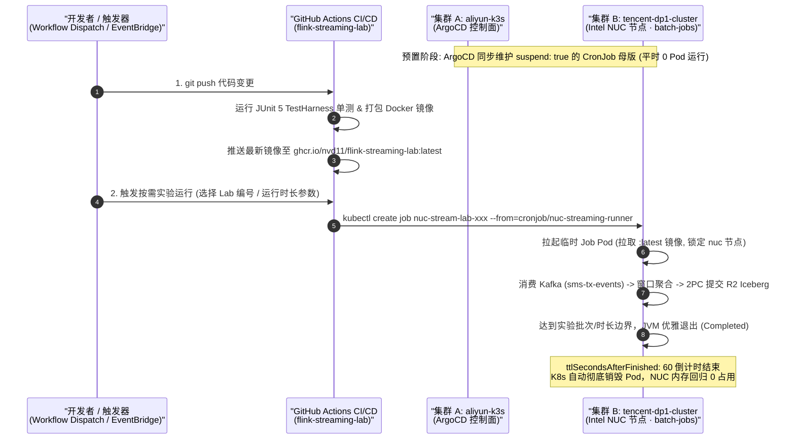

# 技术选型与流湖一体架构方案 (Technical Stack Selection & Lakehouse Architecture)

> 日期：2026年10月  
> 状态：提案与架构基线 (Active Proposal)  
> 核心技术标签：`Java 21 LTS` `Apache Flink 1.20` `Apache Kafka` `Cloudflare R2` `Apache Iceberg` `ArgoCD GitOps` `K3s`

---

## 1. 架构愿景与业务使命 (Vision & Mission)

在传统金融与交易分析架构中，离线数仓（T+1 批处理）与实时告警（内存短平快流处理）往往割裂为典型的 Lambda 架构：业务需维护两套计算引擎、两套存储格式与两套处理逻辑，导致数据口径不一致、存储成本倍增且维护复杂。

本项目旨在构建一套**高可靠、低成本、免维护、纯自闭环且工业级落地的现代流湖一体架构（Streaming Lakehouse Architecture）**：
1. **秒级低延迟动账流计算**：基于 Apache Flink 实现事件时间推进、迟到数据治理与增量聚合；
2. **精准一次（Exactly-Once）入湖持久化**：将清洗与聚合后的交易流低延迟、无缝写入开放数据湖格式 Apache Iceberg；
3. **零出口费率（$0 Egress）极致成本控制**：底层对象存储选用 Cloudflare R2，摆脱传统云厂商昂贵的数据流出账单；
4. **按需即焚式 GitOps 交付（100% 复刻 `sms-flink-etl` 模式）**：由 ArgoCD 维护挂起的 `CronJob` 母版 (`suspend: true`)，结合 GitHub Actions 按需/定时派生一次性实验流任务 Pod (`kubectl create job --from=cronjob/...`)，跑完指定时长或消费完水位后自动优雅销毁 (`ttlSecondsAfterFinished: 60`)，平时零内存占用；
5. **轻量纯粹的测试验证闭环**：坚决剔除 Trino 等沉重外部 OLAP 查询层，采用 Iceberg Java 原生客户端与 Flink Table API 进行进程内纳秒级流式断言，保证单测与实验 100% 独立可复现。

---

## 2. 核心技术选型全景矩阵 (Technology Stack Matrix)

| 架构层级 | 选型组件 | 选定版本 | 核心定位与职责 | 核心替代备选对比 |
|---|---|---|---|---|
| **语言与运行时** | **Java (OpenJDK)** | **21 (LTS)** | 现代类型安全基座、模式匹配、高性能 ZGC/G1 | Java 8/11 (语法陈旧)、Java 17 (过渡版本) |
| **实时计算引擎** | **Apache Flink** | **1.20.0** | 亚秒级有状态事件驱动流计算、Watermark 与窗口状态机 | Spark Streaming (微批延迟偏高)、Dataflow (云厂商强绑定) |
| **实时消息总线** | **Apache Kafka** | **3.8.0 / 4.1.2** | 严格单实体偏序追加日志、SASL 安全隔离、Kong L4 路由 | GCP Pub/Sub (无物理分区序、超时重发穿插乱序) |
| **开放湖仓表格式** | **Apache Iceberg** | **1.6.x / 1.7.0** | ACID 事务保证、隐式分区、元数据树演进、快照回溯与时间旅行 | Apache Hudi (Flink 支持度与元数据偏重)、Delta Lake (Spark 生态绑定深) |
| **数据湖对象存储** | **Cloudflare R2** | **S3 API v4** | 100% S3 兼容、亚太低延迟、**终身永久 $0 出口流量费** | AWS S3 / GCS (出口流量费高昂、跨云访问成本沉重) |
| **元数据 Catalog** | **JDBC Catalog** | **PostgreSQL 协议** | 支撑 Iceberg 元数据指针轻量原子更新、托管于 CockroachDB / PG | Hive Metastore (臃肿沉重、强依赖 Hadoop)、REST Catalog (额外运维维护组件) |
| **计算宿主与编排** | **K3s + Intel NUC** | **v1.36+ (16GB RAM)** | 业务集群 `tencent-dp1-cluster` 亲和性锁定 `nuc` 节点运行 | 公有云常驻大规格 VM (账单高昂、资源利用率低) |
| **CI/CD 与按需调度** | **ArgoCD + GitHub Actions** | **挂起母版 + 按需派生** | ArgoCD 托管 `generic-batch-job` 冻结母版 + Actions 按需唤醒即焚 Pod | 7x24h 常驻 Deployment (实验间隙白白空转耗费内存) |
| **流湖验证与断言** | **Iceberg Client / Flink SQL** | **进程内轻量自验** | `IcebergGenerics` 毫秒级原生断言 + Flink Table API 批流自查 | Trino (沉重外部依赖、杀鸡用牛刀、易受网络与节点波动影响) |

---

## 3. 分层选型深度推导与技术对比 (Deep Rationale & Trade-offs)

### 3.1 运行时基座：为什么选用 Java 21 (LTS)？
* **现代语言特性大幅提升开发效率**：
  * **模式匹配与增强型 Switch**：在处理多变格式的交易动账、短信回执与异常事件时，代码结构极其干净，消除了多层 `instanceof` 类型强转；
  * **Record 类型**：天然适配流计算中的不可变事件模型（如 `FinancialTxEvent`），自带高效的 `equals`、`hashCode` 与 `toString`；
  * **序列化与内存友好**：Java 21 优化的内存布局对 Flink 算子内存管理更加契合，减少垃圾回收压力。
* **现代垃圾回收器**：Java 21 的 G1 与 Generational ZGC 极大压缩了 GC 停顿时间（STW 降至毫秒级甚至亚毫秒级），从根本上避免了因长时 GC 导致 Kafka 消费者心跳超时 (`session.timeout.ms`) 被误判踢出组的灾难事故。

---

### 3.2 计算引擎：为什么坚持 Apache Flink 1.20？
* **原生事件驱动（Native Streaming）**：Flink 针对单条事件即来即算，端到端延迟达毫秒级，而 Spark Streaming 的微批（Micro-batching）机制在金融交易风控拦截场景下天然存在数秒的感知时滞。
* **精密的时间与水位线控制体系**：
  * 原生支持 Bounded Out-of-Orderness 水位线推进；
  * 支持多分区通道空闲标记（`withIdleness`），完美解决多卡槽静默导致下游窗口冻结的木桶死锁；
  * 具备完备的窗口迟到治理三道防线（`allowedLateness` 与 `SideOutput`）。
* **成熟稳定的 Iceberg 流式写入 Connector**：
  * Flink 官方与 Iceberg 社区深度打磨了 `IcebergFilesCommitter` 算子；
  * 基于 Flink Checkpoint 机制实现精准的两阶段提交（Two-Phase Commit, 2PC），确保写入开放数据湖的数据做到**不多不少、恰好一次（Exactly-Once）**。

---

### 3.3 消息中间件：为什么坚持使用带物理分区的 Apache Kafka？
* **严格的单实体时间序（Partial Ordering）**：
  * 通过按卡号/用户唯一标识作为 Key 进行 MurmurHash2 取模，确保同一卡号的所有动账记录严格进入同一个物理 Partition；
  * 相比 GCP Pub/Sub 这类离散无序池，Kafka 物理分区日志提供了无界流状态聚合所必需的确定性时间轴。
* **游标与物理存储解耦**：
  * 数据刻在追加日志中，仅维护长整型 `Offset` 指针，允许下游 Flink 作业在重平衡或故障排查时任意拨回指定时间点进行离线重放；
  * 支持高吞吐 PageCache 零拷贝（`sendfile`），为高并发流处理提供极致吞吐。
* **轻量化 KRaft 架构与边缘部署就绪**：
  * 弃用了沉重的 ZooKeeper 依赖，使得 Kafka 可以稳健运行在边缘节点，并配合集群 Kong L4 网关实施 SASL 认证安全加固。

---

### 3.4 表格式：为什么选择 Apache Iceberg？
* **纯正的流批一体（Streaming Ingestion & Batch Serving）**：
  * Iceberg 将表定义彻底与物理存储路径解耦，通过多级元数据树（`Metadata JSON` $\to$ `Snapshot` $\to$ `Manifest List` $\to$ `Manifest File` $\to$ `Data File`）跟踪数据；
  * 支持小文件定时合并与隐式分区（Hidden Partitioning），查询者无需手工写 `WHERE year = '2026' AND month = '10'`，直接按 `timestamp` 查询即可自动享受分区裁剪。
* **ACID 事务与快照隔离（Snapshot Isolation）**：
  * Flink 正在持续微批流式写入的同时，下游查询读取器只能看到已提交的最新快照，绝不会读到写入中途的半生不熟数据（脏读）。
* **原生支持时间旅行（Time Travel）与回滚**：
  * 针对金融对账中审计回溯的需求，随时可以回滚查询“2026-10-10 12:00:00 这一时刻的财务快照状态”，天然具备金融审计溯源基因。

---

### 3.5 存储与网络成本：为什么选用 Cloudflare R2？
* **核心杀手锏：$0 出口流量费（Zero Egress Fees）**：
  * 在 AWS S3 或 Google Cloud GCS 体系中，跨公网或跨云跨区域读取海量数据时，出口带宽费用极为高昂；
  * Cloudflare R2 实行彻底的出口免流政策，无论下游拉取多少 TB 的 Parquet 数据做大规模即席分析或报表训练，均无额外带宽溢价，极大降低基础设施 TCO。
* **100% 兼容 AWS S3 API (Signature Version 4)**：
  * Flink 的 `flink-s3-fs-hadoop` 插件以及 Iceberg 的 `S3FileIO` 均可原生对接，仅需替换 Endpoint 即可无缝切换，无需任何二次开发。
* **全球 Anycast 边缘网络**：在亚太及海外机房均拥有高可用节点，保障多云分布式算力的高速存取。

---

### 3.6 元数据存储：为什么采用 JDBC Catalog 配合云原生关系数据库？
* **轻量稳健，无冗余组件负担**：
  * 传统大数据方案重度依赖 Hive Metastore (HMS)，不仅需拉起 HMS 独立服务，还需维护 Hadoop 环境与庞大的依附组件；
  * Iceberg 原生支持 `JdbcCatalog`，只需在兼容 PostgreSQL 的关系数据库中维护一张极简的 `iceberg_tables` 元数据表，即可完成表级别的 CAS（Compare-And-Swap）原子快照提交；
* **高可用与高一致性**：配合 CockroachDB Serverless 或托管 PostgreSQL，天然享有分布式事务与多副本容灾，免去元数据单点崩溃隐患。

---

### 3.7 架构精简决策：为什么在实验中坚决弃用 Trino？(Why Trino is Omitted)
在方案论证初期，曾讨论是否引入 Trino 作为统一查询控制台。经深度推导，决定在当前实验体系中**坚决剔除 Trino 依赖**，理由如下：
1. **实验靶标在“计算内核”而非“交互 OLAP”**：
   - 本项目的使命是攻克 Flink 实时时钟推进、乱序延迟容忍、增量预聚合与 2PC 写入湖仓的确定性；
   - 数据的终点只要成功落入 Cloudflare R2 的 Iceberg Snapshot，Flink 的流计算使命即已 100% 完成，引入外挂查询引擎属于典型的过度工程（Over-engineering）。
2. **零依赖与毫秒级单测闭环 (In-Process Verification)**：
   - 依赖外部 Trino 服务会导致本地 JUnit 单元测试受制于网络环境、NUC 节点可用性与 Trino Coordinator 的冷启动，破坏了“毫秒级可复现纯函数式单测”的原则；
   - 直接使用 **Iceberg 原生 Java SDK (`IcebergGenerics.read(table)`)** 或 **Flink 内部 Table API / SQL**，即可在单测进程内以纳秒级速度读取最新提交的快照数据并用 AssertJ 校验字段，更纯粹、更稳定、更快速。

---

## 4. 端到端架构拓扑与数据流转 (End-to-End Data Pipeline)

```text
 ┌────────────────┐
 │ 金融动账/短信  │
 │  Webhook 上报  │
 └───────┬────────┘
         │ (HTTP / API / 边缘转发)
         ▼
 ┌─────────────────────────────────────────────────────────────┐
 │ Apache Kafka (Edge KRaft 集群 / kafka.jppwl.asia:9092)       │
 │ • Topic: sms-tx-events (2 Partitions, Key = CardTail)       │
 │ • 传输层: SASL_PLAINTEXT 安全鉴权, Kong L4 路由              │
 └──────────────────────────────┬──────────────────────────────┘
                                │ (Kafka Source 消费)
                                ▼
 ┌─────────────────────────────────────────────────────────────┐
 │ Apache Flink 1.20 流计算引擎 (Java 21 LTS 运行时)            │
 │                                                             │
 │  [1. 事件时间提取 & BoundedOutOfOrderness 水位线推进]        │
 │                                                             │
 │  [2. 实时聚合与迟到治理]                                    │
 │      ├── 增量预聚合: AggregateFunction (O(1) 状态累加)      │
 │      ├── 窗口元数据: ProcessWindowFunction (补充起止时间)   │
 │      └── 迟到保护: allowedLateness 修正 + 侧输出兜底        │
 │                                                             │
 │  [3. Checkpoint 协调机制]                                   │
 │      └── 两阶段提交 (2PC) 触发 Iceberg Files Committer       │
 └──────────────────────────────┬──────────────────────────────┘
                                │ (Iceberg Stream Sink 写入)
                                ▼
 ┌─────────────────────────────────────────────────────────────┐
 │ 开放数据湖 (Open Lakehouse)                                 │
 │                                                             │
 │  ┌──────────────────────────────────────────────────────┐   │
 │  │ 元数据控制层: Iceberg JDBC Catalog                    │   │
 │  │ (托管于 CockroachDB / PostgreSQL: iceberg-catalog)   │   │
 │  └──────────────────────────┬───────────────────────────┘   │
 │                             │ 原子更新 Snapshot 指针         │
 │                             ▼                               │
 │  ┌──────────────────────────────────────────────────────┐   │
 │  │ 物理存储层: Cloudflare R2 对象存储                    │   │
 │  │ (s3a://sms-flink-etl/iceberg/finance/...)            │   │
 │  │ • 存储格式: Apache Parquet (列存 + 字典压缩)          │   │
 │  │ • 成本特性: 终身 $0 Egress 出口带宽费用              │   │
 │  └──────────────────────────────────────────────────────┘   │
 └──────────────────────────────┬──────────────────────────────┘
                                │ (进程内轻量读取与快照自验)
                                ▼
 ┌─────────────────────────────────────────────────────────────┐
 │ 进程内流湖验证与流式断言 (In-Process Verification)           │
 │ • 验证方式 A: IcebergGenerics.read(table) 纳秒级数据流迭代  │
 │ • 验证方式 B: Flink TableEnvironment.executeSql("SELECT..") │
 │ • 质量保证: JUnit 5 + AssertJ 流式断言 (零外部查询服务依赖)  │
 └─────────────────────────────────────────────────────────────┘
```

---

## 5. 核心配置蓝图与环境变量规范 (Configuration Blueprints)

> **安全红线防范**：所有敏感密钥（Access Key、Secret Key、数据库密码、Kafka 凭证）严禁硬编码至生产配置库中，统一采用环境变量注入或模板替换机制。

### 5.1 Flink S3A 对接 Cloudflare R2 配置模板
```properties
# Flink 连接 S3 兼容系统的核心配置 (flink-conf.yaml 或 JVM 环境变量)
s3.endpoint: https://${CF_ACCOUNT_ID}.r2.cloudflarestorage.com
s3.path.style.access: true
s3.access-key: ${CF_R2_ACCESS_KEY_ID}
s3.secret-key: ${CF_R2_SECRET_ACCESS_KEY}
s3.ssl.enabled: true
```

### 5.2 Flink SQL / Iceberg Catalog 注册模板
```sql
CREATE CATALOG r2_iceberg WITH (
  'type' = 'iceberg',
  'catalog-type' = 'jdbc',
  'catalog-impl' = 'org.apache.iceberg.jdbc.JdbcCatalog',
  'uri' = 'jdbc:postgresql://${CATALOG_DB_HOST}:${CATALOG_DB_PORT}/iceberg-catalog?sslmode=require',
  'jdbc.user' = '${CATALOG_DB_USER}',
  'jdbc.password' = '${CATALOG_DB_PASS}',
  'warehouse' = 's3a://${R2_BUCKET_NAME}/iceberg-warehouse',
  'io-impl' = 'org.apache.iceberg.aws.s3.S3FileIO',
  's3.endpoint' = 'https://${CF_ACCOUNT_ID}.r2.cloudflarestorage.com',
  's3.path-style-access' = 'true'
);
```

### 5.3 Flink Iceberg 流式 Sink 性能调优参数
* `write.format.default`: `parquet`（列式压缩存储，兼顾压缩比与读取性能）
* `write.parquet.compression-codec`: `zstd`（Zstandard 压缩算法，兼顾 CPU 吞吐与体积）
* `write.target-file-size-bytes`: `134217728` (128 MB 目标文件大小，防止海量碎文件产生)
* `commit.interval-ms`: 配合 Flink Checkpoint 间隔设定（建议 30 秒至 1 分钟，保证实时性与元数据提交频次的平衡）

### 5.4 核心业务聚合与风控报警统一规范 (Unified Aggregation & Alert Spec)
* **分组维度 (`keyBy`)**：按银行卡尾号 `cardTail` 分组（每张卡独立计算与触发窗口）；
* **窗口跨度**：5 分钟事件时间窗口（`TumblingEventTimeWindows.of(Duration.ofMinutes(5))` 或 `EventTimeSessionWindows.withGap(Duration.ofMinutes(5))`）；
* **增量聚合指标 (`ExpenseRiskAccumulator`)**：
  1. `totalTxCount` (`BIGINT`)：窗口内该卡所有支出项总笔数；
  2. `totalExpenseAmount` (`DECIMAL(18,2)`)：窗口内该卡所有支出项累计总额；
  3. `transferTxCount` (`BIGINT`)：窗口内类别为 `PERSONAL_TRANSFER`（转账支出）的笔数；
  4. `transferAmount` (`DECIMAL(18,2)`)：窗口内类别为 `PERSONAL_TRANSFER`（转账支出）的累计总额；
* **实时报警判定 (`transferAlert`)**：
  - 当单张卡在 5 分钟窗口内累计转账支出 `transferAmount > 5000.00` 时，标记 `transferAlert = true` 触发大额转账风控报警；
* **迟到修正版本追踪 (`triggerVersion`)**：
  - 窗口首次到达水位线触发时 `triggerVersion = 1`；在 `allowedLateness` 保护期内因迟到数据到达而重开修正时，递增为 `2, 3...`。

---

## 6. 按需即焚式 GitOps 交付与 NUC K3s 编排架构 (On-Demand Ephemeral GitOps Architecture)

为确保实验环境极致轻量、平时 **0 内存与 0 CPU 占用**，本项目在部署形态上 **100% 复刻 `sms-flink-etl` 的“ArgoCD 维护挂起母版 + GitHub Actions 按需唤醒即焚 Pod”混合 GitOps 范式**，彻底摒弃 7x24 小时常驻空转容器的资源浪费。

### 6.1 核心设计哲学：挂起母版与按需派生 (Suspended Template + On-Demand Spawning)

1. **ArgoCD 声明式维护“冻结母版” (`CronJob` with `suspend: true`)**：
   - 在阿里云集群 A (`aliyun-k3s`) 的 ArgoCD 中，基于共享 Helm Chart (`my-shared-helm-charts/charts/generic-batch-job`) 向集群 B (`tencent-dp1-cluster`) 的 `batch-jobs` 命名空间同步一个 `CronJob` 对象；
   - 该 `CronJob` 显式配置 **`suspend: true`** 且调度表达式设为 `0 0 31 2 *`（2月31日永不自动触发）；
   - 母版内固化了节点亲和性 (`kubernetes.io/hostname: "nuc"`)、环境变量密文引用 (`sms-flink-secret`)、镜像拉取策略 (`Always`) 以及 K8s 原生垃圾回收倒计时 (`ttlSecondsAfterFinished: 60`)。
2. **GitHub Actions 按需/定时吹哨唤醒 (`kubectl create job --from=cronjob/...`)**：
   - 当开发者需要运行流式实验、消费验证 Kafka 积压流水或由云端定时调度器触发时，通过 GitHub Actions 工作流连接 K3s API Server；
   - 基于上述挂起的 `CronJob` 母版动态派生一次性 `Job` 实例（或直接复用 `nuc-batch-runner` 母版并动态覆盖镜像为 `ghcr.io/nvd11/flink-streaming-lab:latest` 及实验启动参数）；
   - **优雅收敛与算完即焚**：Flink Streaming 任务支持传入有界截止水位（`Bounded Kafka Offset / Stop Timestamp`）或最大运行时长（`activeDeadlineSeconds`）。实验流处理并落入 R2 Iceberg 快照后，JVM 进程正常退出，Pod 保留 60 秒供 Fluent Bit 完成日志采集，随后由 K8s 内核自动物理销毁，将内存 100% 归还给 NUC 宿主机。

### 6.2 双集群按需触发与即焚流水线时序图



### 6.3 与 `sms-flink-etl` 基建全面对齐矩阵

| 编排维度 | 架构设定值 | 工程收益说明 |
|---|---|---|
| **Helm Chart 基座** | `nvd11/my-shared-helm-charts` (`charts/generic-batch-job`) | 100% 复用既有成熟模板，零重复造轮子 |
| **K8s 命名空间** | `batch-jobs` (集群 B: `tencent-dp1-cluster`) | 直接共享既有 Namespace 与 RBAC 权限及 `sms-flink-secret` 凭证 |
| **母版控制策略** | `suspend: true` + `schedule: "0 0 31 2 *"` | 杜绝集群本地时钟误触发，100% 受控于外部显式指令 |
| **超时与回收保底** | `activeDeadlineSeconds: 1200` + `ttlSecondsAfterFinished: 60` | 20 分钟硬超时防死锁霸占 CPU；跑完留存 60 秒采日志后自动灰飞烟灭 |
| **节点亲和性** | `nodeSelector: kubernetes.io/hostname: "nuc"` | 锁定本地 16GB 内存 Intel NUC，直享高速网络与充裕算力 |

### 6.4 ArgoCD Application 母版声明规范 (`nuc-streaming-runner`)

```yaml
# my-argocd-manifests: ArgoCD Application 定义蓝图
apiVersion: argoproj.io/v1alpha1
kind: Application
metadata:
  name: nuc-streaming-runner
  namespace: argocd
spec:
  destination:
    name: tencent-dp1-cluster
    namespace: batch-jobs
  project: default
  source:
    repoURL: https://github.com/nvd11/my-shared-helm-charts.git
    path: charts/generic-batch-job
    targetRevision: HEAD
    helm:
      values: |
        fullnameOverride: nuc-streaming-runner

        # 核心铁律：本地时钟彻底挂起！100% 由外部 GitHub Actions 唤醒
        suspend: true
        schedule: "0 0 31 2 *"
        activeDeadlineSeconds: 1200
        backoffLimit: 0
        ttlSecondsAfterFinished: 60

        image:
          repository: ghcr.io/nvd11/flink-streaming-lab
          tag: latest
          pullPolicy: Always

        envFrom:
          - secretRef:
              name: sms-flink-secret

        nodeSelector:
          kubernetes.io/hostname: "nuc"

        resources:
          requests:
            cpu: "500m"
            memory: "1Gi"
          limits:
            cpu: "2000m"
            memory: "2Gi"
  syncPolicy:
    automated:
      prune: true
      selfHeal: true
```

---

## 7. 后续待补充演进路线 (Roadmap & Next Steps)

本技术选型方案作为全套流湖基础设施的基石，后续将持续拓展与补充以下前沿演进专题：

1. **[待补充] 湖仓小文件治理与自动 Compact 机制**：
   - 制定流式写入场景下的后台快照到期清理（`expireSnapshots`）与文件压缩合并策略（`rewriteDataFiles`）；
2. **[待补充] 基于 LangChain4j 的 AI 金融报告 Agent 串联**：
   - 结合现有 LiteLLM 网关（Gemini 3.8 Flash）与湖仓快照读取接口（或 Flink SQL），实现由 Agent 自动驱动的每日动账异动归因与 Markdown/Slack 报表推送；
3. **[待补充] 跨地域双活容灾与双流合并方案**：
   - 探索本地边缘 Kafka 与海外备份总线间的消息冗余容灾及双通道对齐机制；
4. **[待补充] 动态风控 CEP 规则下发架构**：
   - 基于 Flink Broadcast State（广播状态流）实现不停机热加载反洗钱与盗刷风控规则。

---

*(文档由 Cindy 协助主人 Jason 整理编制并纳管于 `docs/` 架构基线目录中)*
